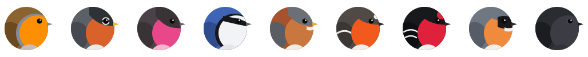
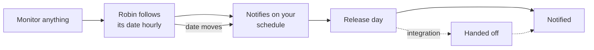
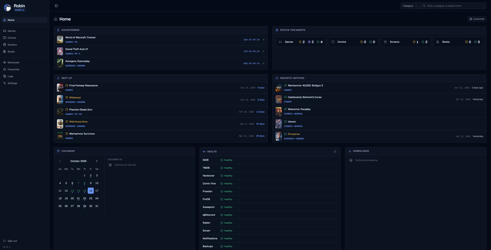
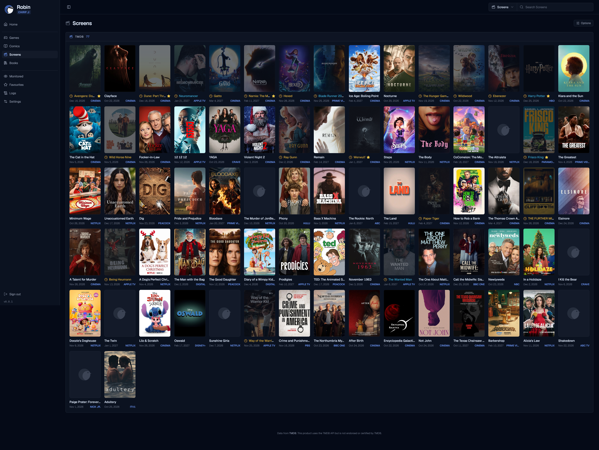
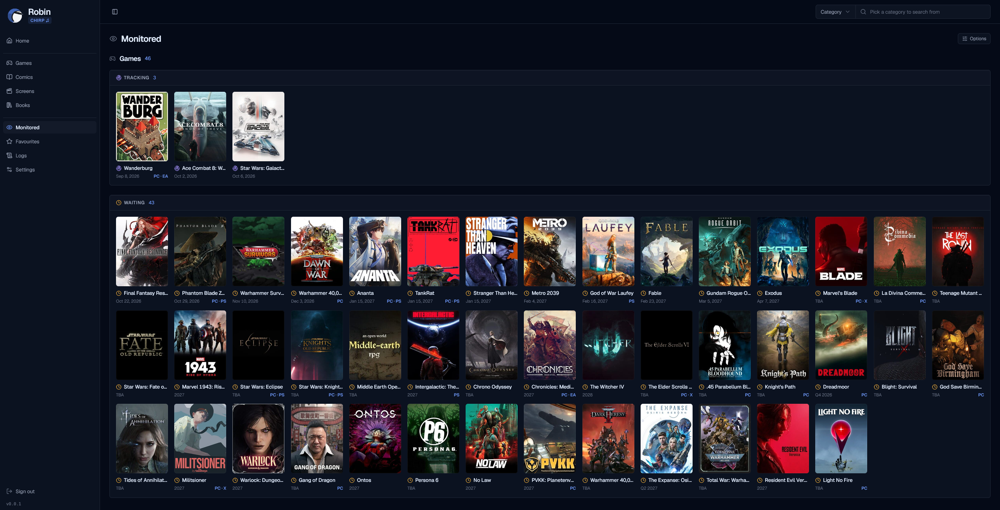
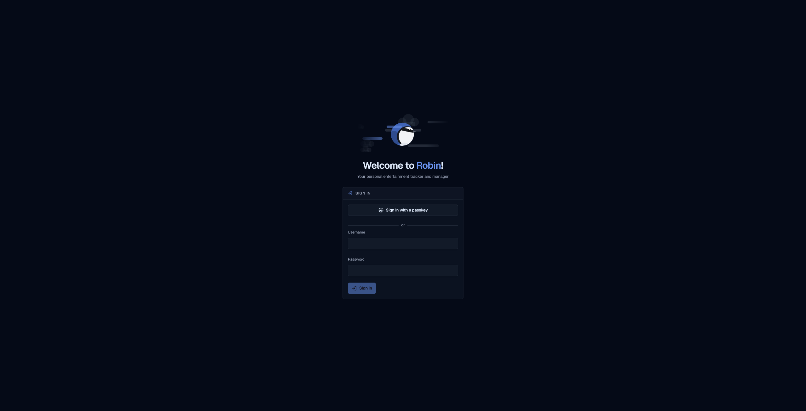

<div align="center">



# Robin

**Your personal entertainment tracker and manager.**

A self-hosted, future release tracker for games, movies, shows, books, comics and possibly more.

[](https://ghcr.io/slightlyuselesscreations/robin)


[](https://ko-fi.com/slightlyuselesscreations)

[What Robin is](#what-robin-is) · [Features](#features) · [How tracking works](#how-tracking-works) · [How integrations work](#how-integrations-work) · [Install](#install) · [What it is not](#what-it-is-not) · [Screenshots](#screenshots) · [Roadmap](#roadmap) · [FAQ](#faq) · [Support](#support)

</div>

<br>

<table>
<tr>
<td width="33%" valign="top">

**Track & Monitor**

Browse what's coming in every category, search by title or cross-reference by who makes it, and then monitor anything with one click.

</td>
<td width="33%" valign="top">

**Hear about it**

Every release date becomes a notification on `ntfy`, Discord, Telegram and many more, set on a schedule like a regular calendar reminder, and held back during quiet hours. With a digest ready for when you come back.

</td>
<td width="33%" valign="top">

**Get it**

By bringing your own infrastructure, `Robin` will also integrate with some third party software to hand-off what it found and make sure you have what you want.

</td>
</tr>
</table>

## What Robin is

`Robin` is your personal companion for tracking many kinds of media. So you can spend less time looking for what's new and more time doing what you love. Instead of keeping tabs on the entire internet for release dates and updates, hand that job over to `Robin`!

At its core, `Robin` tracks entertainment media across various formats while helping you discover what's next. It aggregates free, public databases into a clean, intuitive interface designed to deliver the exact information you need.

Simply put, `Robin` monitors upcoming release dates, tracks changes automatically, and notifies you when something you care about is about to drop.

## Features

### How categories work

`Robin` is divided into `categories` and `integrations`. Here's a table describing them:

| Category | Data source | What you get | Optional integrations |
|---|---|---|---|
| **Games** | `IGDB` | Upcoming PC, PlayStation, Xbox and Nintendo games | `Prowlarr` and `qBittorrent`, PC games only |
| **Screens** | `TMDB` | Upcoming movies and shows for a configured region | `Radarr` and `Sonarr` |
| **Books** | `Hardcover` | Upcoming books and managing your `Want to Read` list on `Hardcover`. | `TBD` |
| **Comics** | `Comic Vine` | Every comic released this week, with the #1 issues marked and a publisher filter. | `Suwayomi` |

And across these categories, other features include:

- A **Home** page that shows what's next, countdowns to the releases you care about most, a calendar and what was recently notified.
- A **Favourites** page displaying favourited developers, franchises, actors, directors, studios, networks, authors or book series. Once an item is favourited, every relation to it can be automatically notified or monitored with two configurable switches.
- **One search bar** for anything that `Robin` can track. Just pick a category and let it run. Then monitor, or favourite.
- **Notifications** are sent on configurable schedules to [`ntfy`](https://ntfy.sh), Discord, Slack, Telegram, Matrix, Gotify, Pushover, Home Assistant and anything else [`Apprise`](https://github.com/caronc/apprise) can reach. Each category can go to its own channel or topic. With optional quiet hours so that you are not bothered when you don't want to.
- **Backups** of everything you set up, encrypted with a passphrase of your choice, taken daily and kept in your data folder. A fresh install can be restored from one during setup.
- A **Logs** page, to see what `Robin` and your integrations are doing, and why something might not be working.

**Everything is optional.** `Robin` is fully modular. A category is enabled by adding its respective API key. If nothing is configured, `Robin` still starts but doesn't do anything. This makes it so you are able to configure only the categories you are interested in.

### How tracking works



- **Follows the date, not a snapshot of one.** A date that moves is announced again, and an undated item you track is announced once it gets one.
- **Nothing missed.** If `Robin` was off when a notice was due, it sends it when it starts again, once.
- **Favourites keep watch for you.** New releases from a favourite item are announced, or monitored automatically. For example, this way you don't have to track every single Larian Studious game! You can just favourite it as a developer, and every single one of their games will be monitored automatically.
- **Hand-off is optional.** With an integration set, what `Robin` finds goes to it: a PC game to `qBittorrent` through `Prowlarr` and `PreDB`, a movie or show to `Radarr` or `Sonarr`, a comic series to `Suwayomi`.

### How integrations work

`Robin`'s capabilities can be enhanced by its integrations. I have tried to at least add one integration per category. This comes with a 'bring-your-own-infrastructure' caveat.

Here's a very brief description of what you can do, with infrastructure you might already run:

1. Monitored `PC` games, when `Prowlarr` is configured, are periodically searched through your instance and its results are checked against a `PreDB` API for release quality and then handed off to `qBittorrent`. When `PreDB` can't vouch for a release, `Robin` requests your intervention.
2. When `Suwayomi` is configured, the comics page will display your installed extension's latest series. And the #1 issues of the week, once monitored are searched against it until they are found and added directly to your `Suwayomi` library.
3. When `Sonarr` or `Radarr` are configured, `Robin`'s `Home` page calendar will reflect your `*arr` stack. Items that are already present in your stack will be marked by color coding names in the `Screens` page of `Robin`. And when you monitor something from `Robin` you can automatically add them to your stack, or do it manually. Anything your stack already holds that hasn’t come out yet is monitored in Robin automatically.

It is important to understand that these integrations are all optional. `Robin` does not require you to have them to do its biggest job.

## Install

`Robin` is one container. Save this as `docker-compose.yml`:

```yaml
services:
  robin:
    image: ghcr.io/slightlyuselesscreations/robin:latest
    container_name: robin
    restart: unless-stopped
    user: '1000:1000'
    ports:
      - '8080:8080'
    environment:
      TZ: UTC
    volumes:
      - ./data:/data
```

Then, next to it:

```bash
mkdir -p data && sudo chown 1000:1000 data
docker compose up -d
```

On its first start, `Robin` prints a one-time password in its log:

```bash
docker logs robin
```

Open `http://<your-server>:8080`, sign in with it and choose your own password. Setup then walks you through the rest, one step at a time, and everything in it can be skipped and changed later under Settings.

> [!TIP]
> Locked out? `docker exec robin python -m robin.auth reset` turns off two factor, removes your passkeys, signs everyone out and prints a new one-time password right there, in place of your old one.

- `TZ` is the time zone your notifications follow, such as `Europe/Paris`.
- `user` must own `./data`. Use your own `uid:gid` in both places if it isn't `1000:1000`, `99:100` on Unraid for example.
- `latest` is the newest release. Pin a version such as `0.0.1` to stay on it.

## What it is not

- **Not designed for the open internet:** `Robin` is not something you should open up to the internet. Use it at home, or through a VPN.
- **Not a requests handler:** `Robin` is managed by one account, no other users, no requests to approve
- **Not a downloader:** Robin does not download anything. If you have your own infrastrucure, that job is handed over.
- **Not a backlog catalogue:** `Robin` lists what's coming, from tomorrow on. (With the exception of comic books)
- **Not a library manager or player.** Once a release date has passed, `Robin` will stop caring about it. Including caring about anything from its configured integrations with your infrastructure. It will not manage lifecycle of anything past what it is designed to do, and definitely not for anything that has to do with the integrations it briefly talks to.

## Screenshots






## Roadmap

Provisional, and subject to change.

- [x] Multi-arch image (arm64)
- [x] Back up and restore settings
- [ ] Calendar export (iCal)
- [x] More notification targets beside `ntfy`
- [ ] Steam wishlist import
- [ ] Music category
- [ ] Mobile-first layout / Mobile app
- [ ] An integration for books

## FAQ

<details>
<summary><b>Why did I get the same notice twice?</b></summary>

<br>

The release date moved. `Robin` announces each date once, so a new date is a new notice.

</details>

<details>
<summary><b>Why is a category missing?</b></summary>

<br>

Its data source isn't set. Add its key under Settings and it appears.

</details>

<details>
<summary><b>Why is a title shown without a date?</b></summary>

<br>

The source only gives a window, like "Q2 2026" or "2027". `Robin` shows it as the source words it and tells you once a real day is set.

</details>

<details>
<summary><b>Can I build it myself?</b></summary>

<br>

```bash
docker build -t robin .
```

Or run it from source with [uv](https://docs.astral.sh/uv/) and [pnpm](https://pnpm.io): `pnpm install && pnpm build` in `frontend/`, then `uv run uvicorn robin.main:app --port 8080` in `backend/`, which serves the built frontend too.

</details>

## Built with

[FastAPI](https://fastapi.tiangolo.com) · SQLite · [httpx](https://www.python-httpx.org) · [React](https://react.dev) · [Vite](https://vite.dev) · [Tailwind](https://tailwindcss.com) · [shadcn/ui](https://ui.shadcn.com) · [TanStack](https://tanstack.com)

Data from [`IGDB`](https://www.igdb.com), [`TMDB`](https://www.themoviedb.org), [`Hardcover`](https://hardcover.app), [`Comic Vine`](https://comicvine.gamespot.com) and [`PreDB`](https://predb.net). 

*This product uses the `TMDB` API but is not endorsed or certified by `TMDB`.*

## License

`Robin` is licensed under the [GNU AGPL v3](LICENSE). You are free to use it, change it and share it. If you run a changed version of `Robin` for other people, you have to share your changes with them too.

## Support

`Robin` is free. If you like this project please consider helping me out. Any cent will go into making sure `Robin` is updated, bug free and stays slightly useful for the foreseeable future.

<a href="https://ko-fi.com/slightlyuselesscreations"></a>

## Slightly useless creations AI usage disclaimer

Like all other projects under `slightlyuselesscreations`, **90%** of this repository has been generated by Claude Opus 5+ with High reasoning effort. With code audits and reviews performed by Ponytail.

The only human "effort" gone into this project is purely conceptual, directional, monetary, in testing and in presentation.

I am an IT senior professional with solid grasp of modern IT concepts, but I am not a programmer of any relevant skill or passion whatsoever.

I take pride and passion into creating something I would use myself, and let everyone else join in. But AI generated software is still just that. I cannot take pride into anything past my idea, because I have done **10%** of the work.

If you do not trust LLMs or me, **DO NOT** use this software. And I recommend you continue being skeptical.

If you have the skill to check past what little I have done, and will be doing as I learn, and want to let me know, I urge you to do so.

Contributions to my projects are allowed exclusively when in direct collaboration with human programmers. I will not vet random full LLM contributions, so they will not be accepted. Kick rocks.
