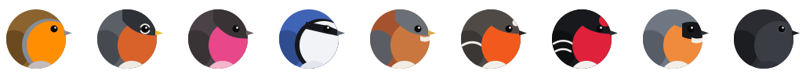
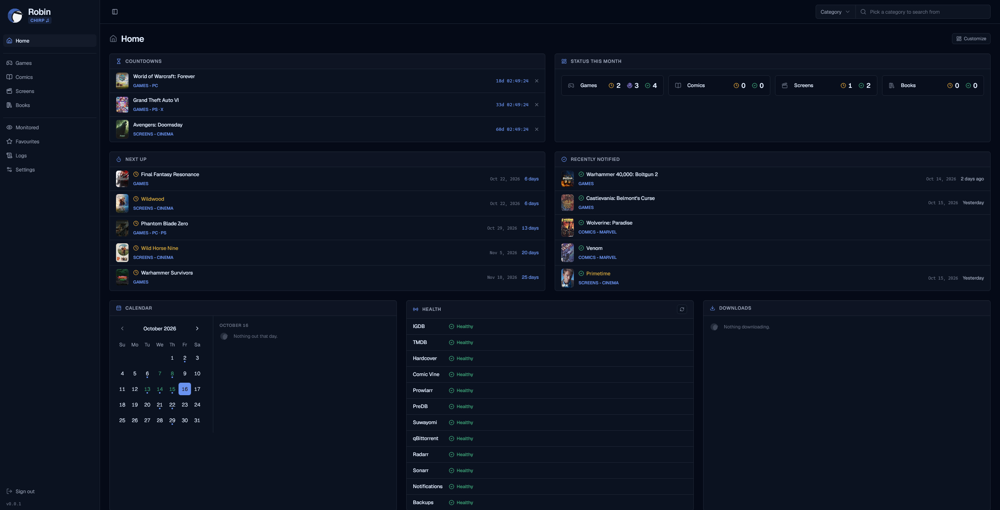
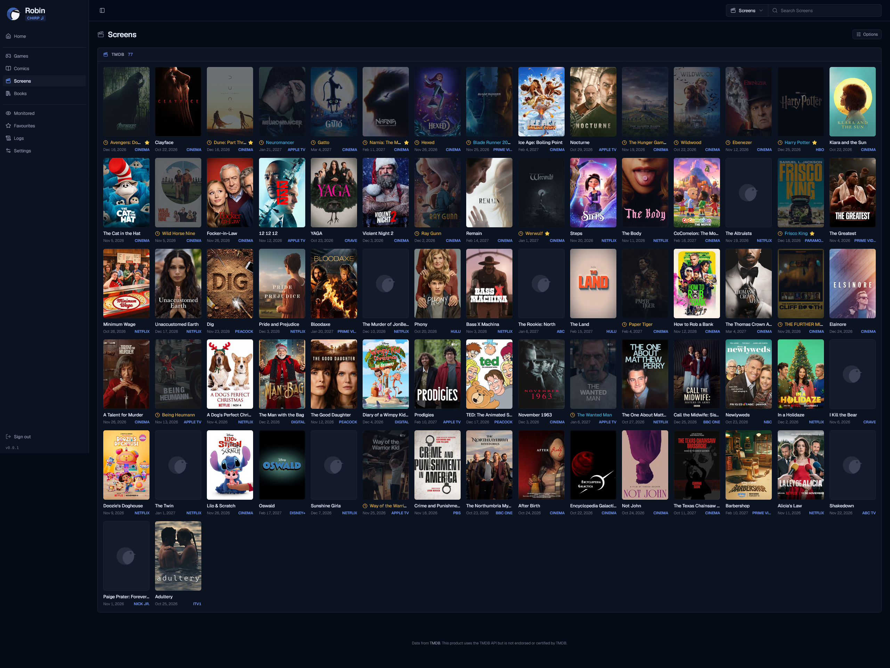
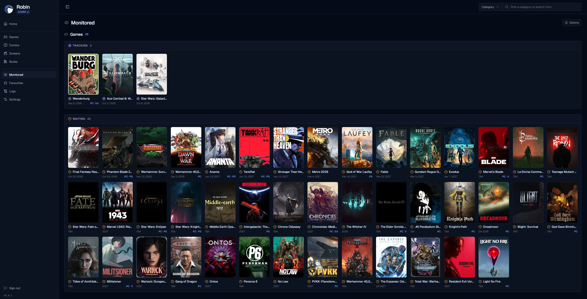
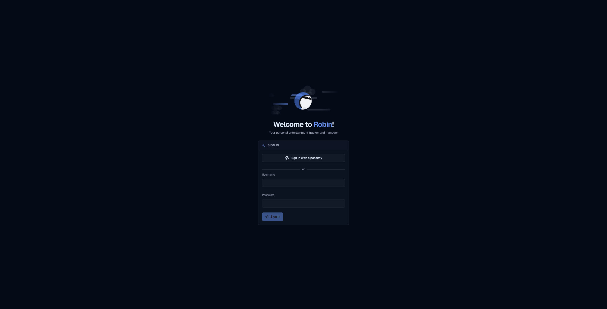

<div align="center">



# Robin

**Your personal entertainment tracker and manager.**

A self-hosted, future release tracker for games, movies, shows, books, comics and possibly more.

[](https://ghcr.io/slightlyuselesscreations/robin)


[](https://ko-fi.com/slightlyuselesscreations)

[What Robin is](#what-robin-is) · [Features](#features) · [How tracking works](#how-tracking-works) · [How integrations work](#how-integrations-work) · [Install](#install) · [What it is not](#what-it-is-not) · [Screenshots](#screenshots) · [Roadmap](#roadmap) · [FAQ](#faq) · [Support](#support)

</div>

<br>

<table>
<tr>
<td width="33%" valign="top">

**Track & Monitor**

Browse what's coming and then keep anything monitored with one click.

</td>
<td width="33%" valign="top">

**Hear about it**

Every release date becomes a notification. You can set on a schedule exactly like a regular calendar reminder. It can also be held back during quiet hours. With a digest ready for when you come back.

</td>
<td width="33%" valign="top">

**Get it**

By bringing your own infrastructure, `Robin` will also integrate with some third party software to hand-off what it found.

</td>
</tr>
</table>

## The idea behind

`Robin` is your personal companion for tracking many kinds of entertainment media. So you can spend less time looking for what's new and more time doing what you love. Instead of keeping tabs on the entire internet for release dates and updates, hand that job over to `Robin`!

It aggregates free, public databases into a clean, intuitive interface designed to deliver the exact information you need.

Simply put, `Robin` monitors upcoming release dates, tracks changes automatically, and notifies you when anything happens to what you look forward to.


I consider `Robin` to be feature stable. That said, there are new features planned. So please expect rapid development, and many breaking changes. Stick on `:latest` to be safer. Ideally the release cycle for robin is one week of development, one week of testing. So one, or two (at most) releases every two weeks. (This does not include bugfixes, or security updates.)

## How does it work (in short-ish)

`Robin` shifts its objects into three different phases, makine one lifecycle:

1. `Monitored` is the initial phase, once you monitor an item you are waiting to hear more about it. `Robin` will track it's release date hourly, and if anything changes you will be notified. Or, depending on how (or when) you want to be notified, it will warn you of an imminent release. Or about its status on the next phase.
2. `Tracked` this is a state that appears exclusively when you have a supported integration configured that a category's item also supports. It is a state AFTER an official release has already happened, but you're still waiting for an integration to do its job before `Robin` can move to the next phase.
3. `Notified` this is an object's final phase in its lifecycle. At this point `Robin` is aware that you either actually got notified of an approaching release and/or got what you wanted from an integration that was handling that item up to that point.

After these three phases are over, `Robin` could not care less about what happens to that item. The next day it will completely forget about it.

Each item type `Robin` can manage is divided into `categories` and each one of them has `integrations` that might enhance them. Here's a table:

| Category | Data source | What you get | Optional integrations |
|---|---|---|---|
| **Games** | `IGDB` | Upcoming PC, PlayStation, Xbox and Nintendo games | `Prowlarr` and `qBittorrent`, PC games only |
| **Screens** | `TMDB` | Upcoming movies and shows for a configured region | `Radarr` and `Sonarr` |
| **Books** | `Hardcover` | Upcoming books and managing your `Want to Read` list on `Hardcover`. | `TBD` |
| **Comics** | `Metron` | Every comic released each week, this week first, with the #1 issues marked and a publisher filter. | `Suwayomi` |

Keep in mind that **everything is optional.** `Robin` is fully modular. A category is enabled by adding its respective source's API key. If none are configured, `Robin` still starts, but doesn't do anything. This makes it so you are able to configure the categories of media you are interested in, and nothing else.

### How integrations work

`Robin`'s capabilities can be enhanced by its integrations. I have tried to at least add one integration per category. This comes with a 'bring-your-own-infrastructure' caveat.

Here's a very brief description of what you can do, with infrastructure you might already run:

1. Monitored `PC` games: when `Prowlarr` is configured, a PC game is periodically searched through your instance and its results are checked against a `PreDB` API for release quality and then handed off to `qBittorrent`. When `PreDB` can't vouch for a release, `Robin` requests your intervention, and the hand off is manual.
2. When `Suwayomi` is configured with a source capable of displaying comics, you will be able to track comic books that are releasing each week, and also browse the source itself directly from `Robin`, adding any comic to the Suwayomi library itself. Both from the comics found in `Metron` or directly from `Suwayomi`'s source.
3. When `Sonarr` or `Radarr` are configured: `Robin`'s `Home` page calendar will reflect your `*arr` stack. Items that are already present in your stack will be marked by color coding their names around `Robin`. And when you monitor something from `Robin` you can set it up to automatically add them to your stack, or do it manually. Anything your stack already holds that hasn’t come out yet and isn't already on `Robin` can also be automatically monitored.

It is important to understand that these integrations are all optional. `Robin` does not require you to have them to do its biggest job.

### How `favourites` work

The `favourites` feature is one of `Robin`'s most powerful tools. In short, it allows you to automatically monitor anything that your favourited item has in store for the future.

In practical terms: a simple example would be favouriting the `Marvel` movie studio. By doing that, `Robin` will make sure that any movie appearing from it is automatically monitored. The same goes for almost anything that a certain item has metadata for. You could favourite a comic book series, a character within one, a character from a movie, an actor in one, TV network, a specific director, an entire franchise or even a specific comic book arist you love.

## Install

`Robin` is one container. Save this as `docker-compose.yml`:

```yaml
services:
  robin:
    image: ghcr.io/slightlyuselesscreations/robin:latest
    container_name: robin
    restart: unless-stopped
    user: '1000:1000'
    ports:
      - '8080:8080'
    environment:
      TZ: UTC
    volumes:
      - ./data:/data
      # Backups can also go on another disk, so losing ./data does not lose them too.
      # - /mnt/backup/robin:/data/backups
```

Then, next to it:

```bash
mkdir -p data && sudo chown 1000:1000 data
docker compose up -d
```

On its first start, `Robin` prints a one-time password in its log:

```bash
docker logs robin
```

Open `http://<your-server>:8080`, sign in with it and choose your own password. Setup then walks you through the rest, one step at a time, and everything in it can be skipped and changed later under Settings.

> [!TIP]
> Locked out? `docker exec robin python -m robin.auth reset` turns off two factor, removes your passkeys, signs everyone out and prints a new one-time password right there, in place of your old one.

- `TZ` is the time zone your notifications follow, such as `Europe/Paris`.
- `user` must own `./data`. Use your own `uid:gid` in both places if it isn't `1000:1000`, `99:100` on Unraid for example.
- `latest` is the newest release. Pin a version such as `0.0.1` to stay on it.

## What it is not

- **Not designed for the open internet:** `Robin` is not something you should open up to the internet. It is secure, and always will be. But I do **not** recommend exposing it to the internet. That is not something I am stressing about.
- **Not a multiple user requests handler:** `Robin` is managed by one account, no other users, no requests to approve. And no plans to make it into one. There are other great projects for this, one of them being: [Seerr](https://seerr.dev/)
- **Not a downloader:** Robin does not download anything. If you have your own infrastrucure, that job is handed over.
- **Not a backlog catalogue:** `Robin` lists what's coming, from tomorrow on.
- **Not a library manager or player.** Once a release date has passed, `Robin` will stop caring about it. Including caring about anything from its configured integrations with your infrastructure. It will not manage lifecycle of anything past what it is designed to do, and definitely not for anything that has to do with the integrations it briefly talks to.

## Screenshots






## Roadmap

Provisional, and subject to change.

- [x] Multi-arch image (arm64)
- [x] Back up and restore settings
- [ ] Calendar export (iCal)
- [x] More notification targets beside `ntfy`
- [ ] Steam wishlist import
- [ ] Music category
- [ ] Mobile-first layout / Mobile app
- [ ] An integration for books

## FAQ

<details>
<summary><b>Why did I get the same notice twice?</b></summary>

<br>

The release date moved. `Robin` announces each date once, so a new date is a new notice.

</details>

<details>
<summary><b>Why is a category missing?</b></summary>

<br>

Its data source isn't set. Add its key under Settings and it appears.

</details>

<details>
<summary><b>Why is a title shown without a date?</b></summary>

<br>

The source only gives a window, like "Q2 2026" or "2027". `Robin` shows it as the source words it and tells you once a real day is set.

</details>

<details>
<summary><b>Can I build it myself?</b></summary>

<br>

```bash
docker build -t robin .
```

Or run it from source with [uv](https://docs.astral.sh/uv/) and [pnpm](https://pnpm.io): `pnpm install && pnpm build` in `frontend/`, then `uv run uvicorn robin.main:app --port 8080` in `backend/`, which serves the built frontend too.

</details>

## Built with

[FastAPI](https://fastapi.tiangolo.com) · SQLite · [httpx](https://www.python-httpx.org) · [React](https://react.dev) · [Vite](https://vite.dev) · [Tailwind](https://tailwindcss.com) · [shadcn/ui](https://ui.shadcn.com) · [TanStack](https://tanstack.com)

Data from [`IGDB`](https://www.igdb.com), [`TMDB`](https://www.themoviedb.org), [`Hardcover`](https://hardcover.app), [`Metron`](https://metron.cloud) and [`PreDB`](https://predb.net). 

*This product uses the `TMDB` API but is not endorsed or certified by `TMDB`.*

## License

`Robin` is licensed under the [GNU AGPL v3](LICENSE). You are free to use it, change it and share it. If you run a changed version of `Robin` for other people, you have to share your changes with them too.

## Support

`Robin` is free. If you like this project please consider helping me out. Any cent will go into making sure `Robin` is updated, bug free and stays slightly useful for the foreseeable future.

<a href="https://ko-fi.com/slightlyuselesscreations"></a>

## Slightly useless creations AI usage disclaimer

Like all other projects under `slightlyuselesscreations`, **90%** of this repository has been generated by Claude Opus 5+ with High reasoning effort. With code audits and reviews performed by Ponytail.

The only human "effort" gone into this project is purely conceptual, directional, monetary, in testing and in presentation.

I am an IT senior professional with solid grasp of modern IT concepts, but I am not a programmer of any relevant skill or passion whatsoever.

I take pride and passion into creating something I would use myself, and let everyone else join in. But AI generated software is still just that. I cannot take pride into anything past my idea, because I have done **10%** of the work.

If you do not trust LLMs or me, **DO NOT** use this software. And I recommend you continue being skeptical.

If you have the skill to check past what little I have done, and will be doing as I learn, and want to let me know, I urge you to do so.

Contributions to my projects are allowed exclusively when in direct collaboration with human programmers. I will not vet random full LLM contributions, so they will not be accepted. Kick rocks.
